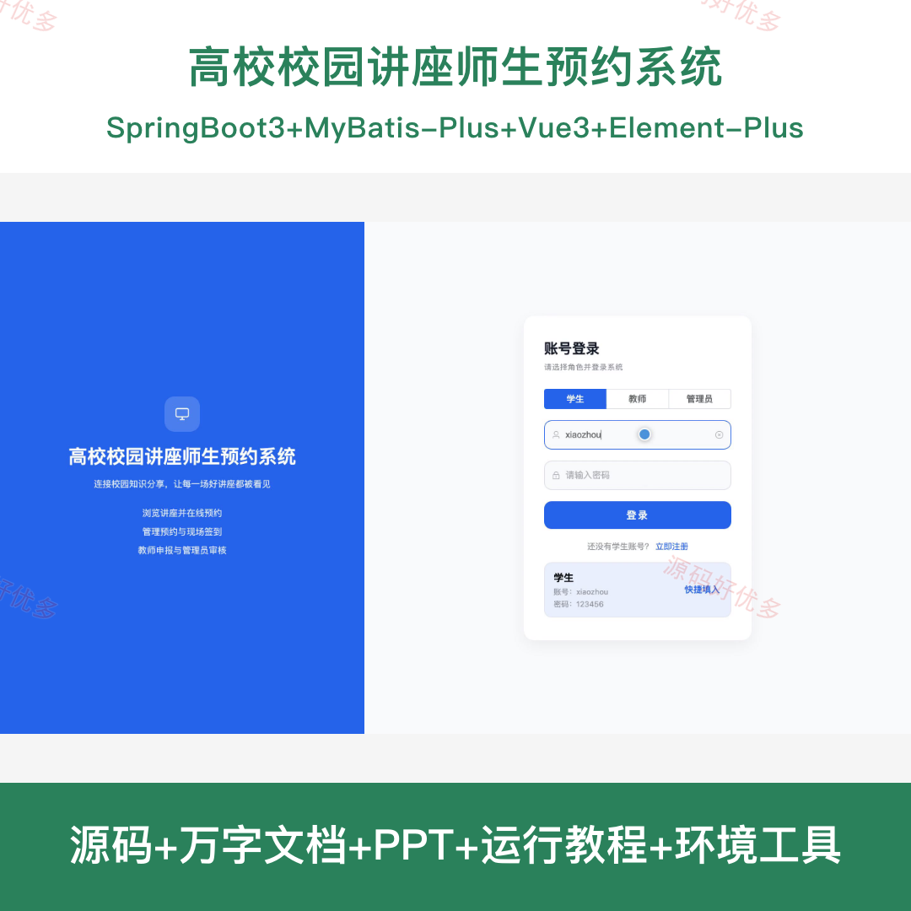
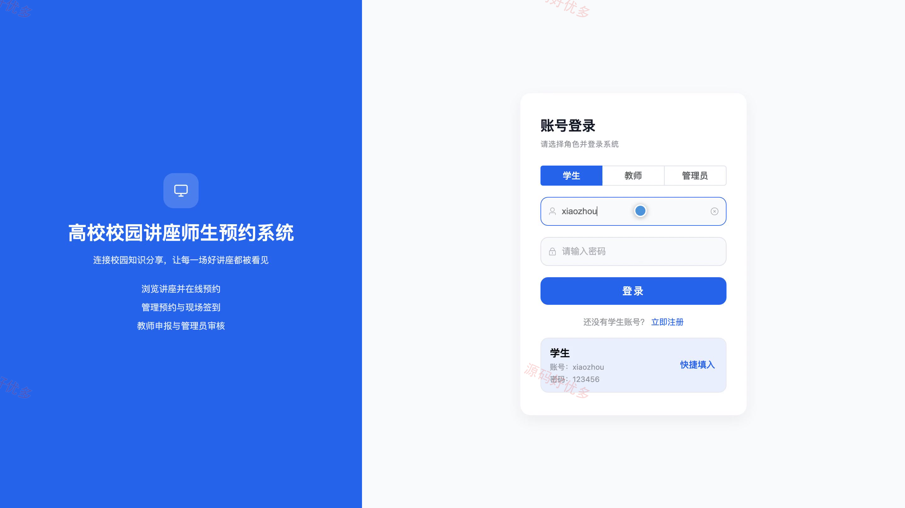
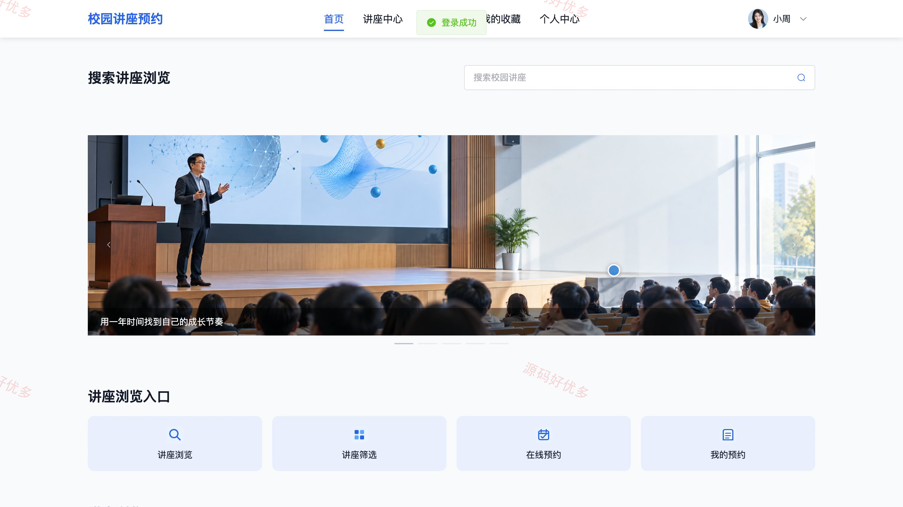
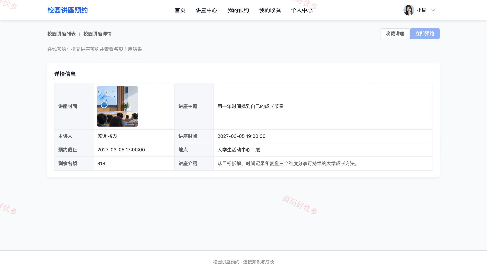
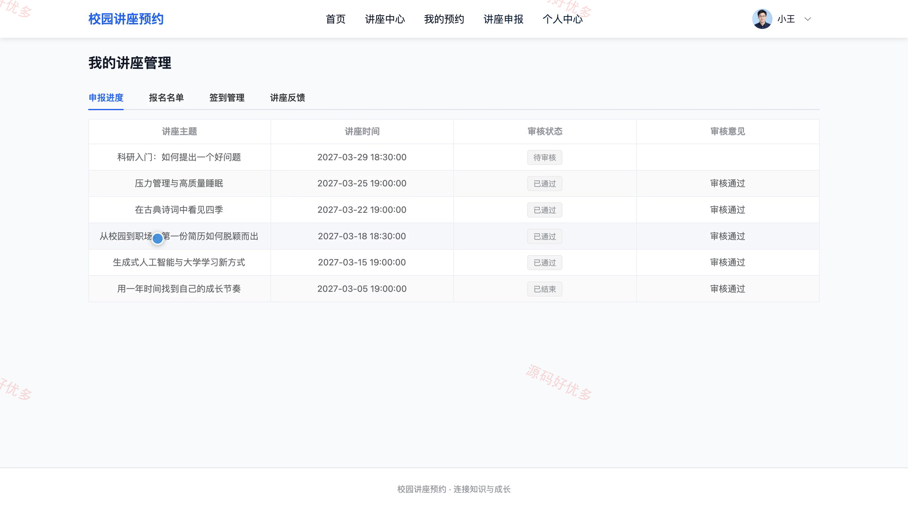
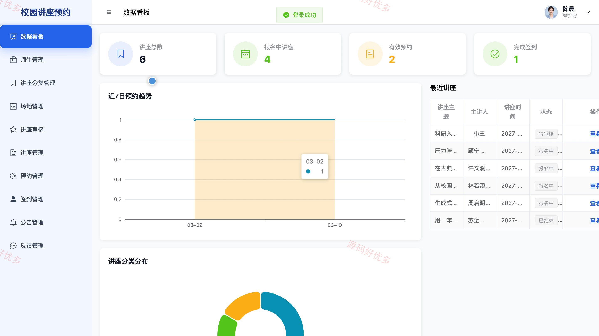
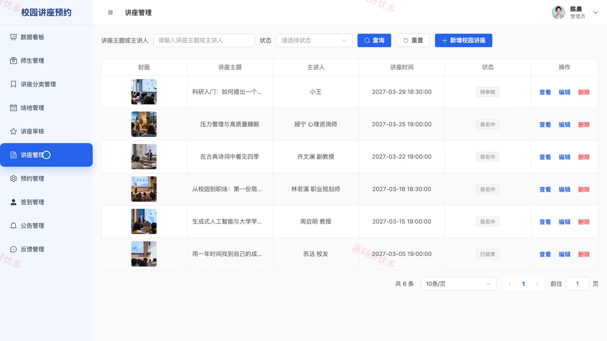
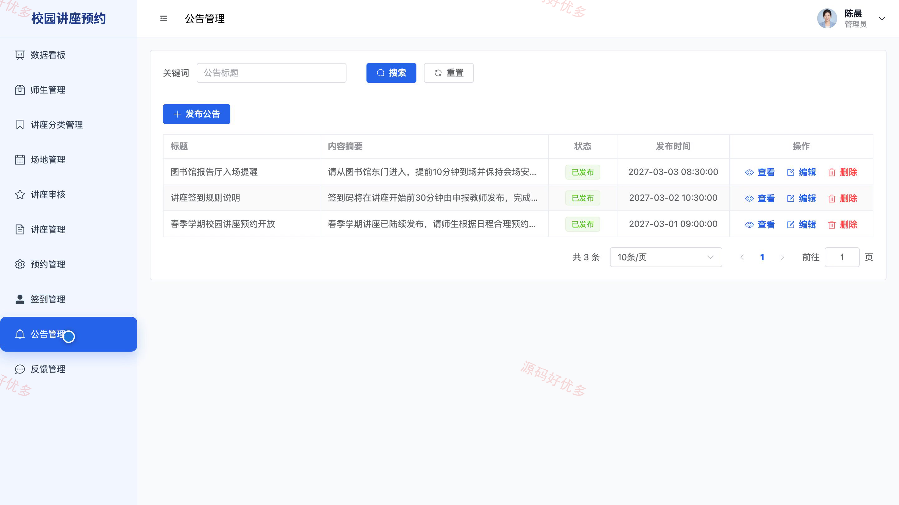

# bs134A
bs134A高校校园讲座师生预约系统源码 Java SpringBoot3 Vue3 前后分离
## 源码问题查看主页咨询

### 一、关键词
校园讲座、学术报告、讲座报名、活动预约、师生交流

### 二、作品包含
源码+数据库+万字设计文档+PPT+全套环境和工具资源+本地部署教程

### 三、项目技术
前端技术： Html、Css、Js、Vue3.4、Element-Plus
后端技术：Java、SpringBoot3.2.0、MyBatis-Plus

### 四、运行环境要求
开发工具：IDEA/eclipse + VSCODE

数据库：MySQL5.7+（共8张表）

数据库管理工具：Navicat10以上版本

环境配置软件： JDK17 + Maven3.6

前端Nodejs：20

浏览器：谷歌浏览器

### 五、项目介绍
项目编号：bs134A

面向高校师生的校园讲座预约系统，支持按分类和时间查找讲座、在线预约与现场签到；教师可申报和管理讲座，管理员负责审核、场地及预约管理。

角色：学生、教师、管理员

学生功能：讲座检索与详情查看、在线预约与取消、我的预约查询、现场签到、讲座评价反馈、讲座收藏、个人资料维护。

教师功能：讲座浏览与预约、讲座申报、申报进度查看、报名名单与状态查看、发布签到口令、签到情况查看、讲座反馈查看。

管理员功能：师生账号管理、讲座分类管理、场地管理、讲座审核与维护、预约管理、签到管理、公告管理、反馈管理。

### 六、运行截图

